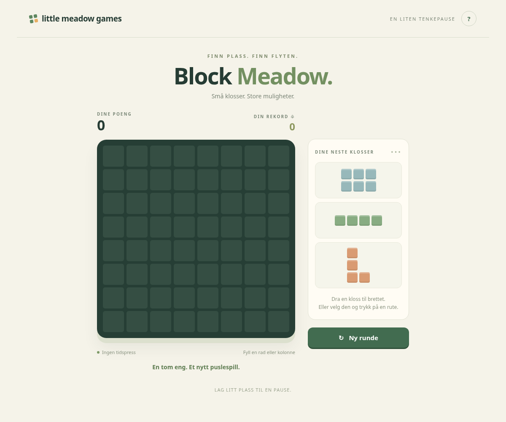

# test-prosjekt

## Block Meadow – spill i nettleseren

[Last ned spillet (ZIP)](https://github.com/jesper-b-johannsen/test-prosjekt/raw/refs/heads/main/Block-Meadow.zip)

Pakk ut ZIP-filen og dobbeltklikk **Block-Meadow.html**. Ingen installasjon er nødvendig.

[Spilleregler og teknisk informasjon](block-meadow/README.md)

## MindSprout — neste prototype

[Les byggeplanen for MindSprout](docs/MINDSPROUT-PLAN.md). Planen beskriver to spill, dagsøkt, lokal lagring, mobiltilgang og krav til testing. MindSprout-versjonen er ikke bygget eller publisert ennå.
